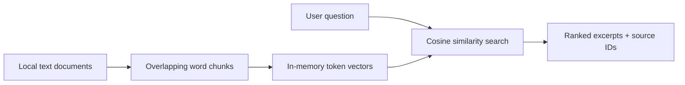

# Enterprise RAG Assistant

**.NET 10 / C# · local document retrieval · optional Azure OpenAI grounded answers**

An end-to-end .NET 10/C# retrieval-augmented generation portfolio project with an offline-first CLI and HTTP API, optional Azure OpenAI embeddings and grounded generation, Azure AI Search, Entra ID security, OpenTelemetry, Bicep infrastructure and GitHub Actions CI/CD. **The default demo runs locally without Azure credentials.**

**Start here:** [System architecture](docs/architecture.md) · [5–7 minute demo](docs/demo-walkthrough.md) · [Interview-ready project highlights](docs/portfolio-highlights.md) · [Testing evidence and limits](docs/testing-and-resilience.md).

## Hiring-manager quick tour

**What this demonstrates:** C#/.NET 10 backend architecture, document ingestion and retrieval, optional Azure AI integration, cloud security patterns, telemetry, tests, and infrastructure as code. Local mode is reproducible without Azure credentials.

- [System architecture](docs/architecture.md) — data flow and tradeoffs.
- [5–7 minute demo](docs/demo-walkthrough.md) — reproducible walkthrough.
- [Portfolio highlights](docs/portfolio-highlights.md) — implementation summary.
- [Tests and limitations](docs/testing-and-resilience.md) — what is validated and what remains unverified.

The optional Azure-backed features need separate provisioning and credentials; the documentation does not claim a verified production deployment.

## Architecture



## Run locally

Install .NET 10 SDK, then from the repository root:

```bash
dotnet run --project src/EnterpriseRag -- ask "How should latency incidents be handled?"
dotnet test tests/EnterpriseRag.Tests/EnterpriseRag.Tests.csproj
```

Provide additional UTF-8 text documents as arguments after the question. The default example is `samples/operations.txt`.

## Optional AI mode

Configure Azure OpenAI credentials as described in [the setup guide](docs/azure-openai.md), then run:

```bash
dotnet run --project src/EnterpriseRag -- ask "How should latency incidents be handled?" --ai
```

The AI mode may incur Azure usage charges. It is disabled by default.

## Semantic search (optional)

With an Azure OpenAI embedding deployment configured, use `--semantic` to rank document chunks by neural embedding similarity instead of lexical overlap. Combine `--semantic --ai` for generated answers from semantic search results. See [semantic search setup](docs/semantic-search.md).

```bash
dotnet run --project src/EnterpriseRag -- ask "How do we address processing delays?" --semantic
```

## Persistent local vector index

Index document embeddings once and reuse them for later searches. See [vector index commands](docs/vector-index.md) for setup and CLI examples. This local JSON-backed index is a prototype, not Azure AI Search.

## Azure AI Search (optional)

Use `--azure-search` with the `index`, `search`, or `delete` commands to select a cloud-hosted vector index. The Azure AI Search index schema must be provisioned first. See [Azure AI Search setup](docs/azure-ai-search.md). The local JSON index remains the default.

## PDF ingestion and retrieval evaluation

Text-based PDFs and UTF-8 text documents can now be read by the same ingestion pipeline. Run a deterministic retrieval accuracy@1 check with `dotnet run --project src/EnterpriseRag -- eval evals/cases.json samples/operations.txt`. See [PDF and evaluation guide](docs/pdf-ingestion-and-evals.md). Scanned PDFs require OCR, which is not included.

## Reliability and telemetry

Cloud adapters now use bounded retries for transient HTTP failures and emit ActivitySource/Meter telemetry without recording prompt text or API keys. See [operations and security notes](docs/operations.md).

## Microsoft Entra ID (optional)

Set `AZURE_AUTH_MODE=entra` to use DefaultAzureCredential for Azure OpenAI and Azure AI Search instead of API keys. Configure the required Azure RBAC roles; see [Entra ID authentication](docs/entra-auth.md). API-key mode remains the default.

## Docker demo (no Azure credentials)

```bash
docker build -t enterprise-rag-assistant:local .
docker run --rm enterprise-rag-assistant:local ask "How should latency incidents be handled?"
docker run --rm enterprise-rag-assistant:local eval evals/cases.json samples/operations.txt
```

See [Docker demo instructions](docs/docker-demo.md) for running with your own documents. The image is a CLI, not an HTTP service.

## HTTP API (offline demo)

Run `dotnet run --project src/EnterpriseRag.Api --urls http://localhost:5080` for `/health`, `/documents` and `/ask` endpoints. See [HTTP API guide](docs/http-api.md). A separate `Dockerfile.api` packages the web service without changing the CLI container.

## Azure-backed HTTP API (optional)

Set `RAG_BACKEND=azure` to connect the API to Azure OpenAI embeddings, Azure AI Search, and grounded answer generation. See [cloud API setup](docs/cloud-api.md). The default API remains offline and credential-free.

## API authentication and tenant isolation

In Azure-backed API mode, requests require a validated Microsoft Entra ID access token and are routed to a tenant-specific Azure AI Search index. Configure `AZURE_TENANT_ID` and `AZURE_API_AUDIENCE` and provision tenant indexes; see [API security](docs/api-security.md). Offline demo mode remains unauthenticated and is not suitable for public exposure.

## Azure Container Apps infrastructure

Bicep templates in `infra/` define an Azure Container Registry, managed identity, and Container Apps deployment with internal-only ingress by default. See [Azure deployment guide](docs/azure-deployment.md). No Azure resources are created by CI.

## Azure AI infrastructure (optional)

`infra/ai.bicep` provisions Azure OpenAI deployments and Azure AI Search with managed identity permissions; `scripts/provision-search-index.sh` provisions the tenant-specific vector index. See [AI infrastructure deployment](docs/azure-ai-infrastructure.md). Azure deployment is opt-in and may incur charges.

## Observability and monitoring

The API emits OpenTelemetry traces and metrics for HTTP requests and cloud dependencies, and JSON console logs. Set `APPLICATIONINSIGHTS_CONNECTION_STRING` for Azure Monitor export. The optional `infra/monitoring.bicep` creates Application Insights, Log Analytics, and a failed-request alert. See [observability guide](docs/observability.md).

## Azure CI/CD deployment

The [manual GitHub Actions deployment workflow](.github/workflows/deploy-azure.yml) tests and builds the API, then uses GitHub OIDC to push an immutable image to Azure Container Registry and update an existing Azure Container App. The deployment job uses the protected `azure-production` environment. See [Azure CI/CD setup](docs/azure-cicd.md).

## Integration and load testing

CI verifies ingestion, retrieval, replacement, deletion, concurrent in-memory operations, cloud retry/cancellation behavior, and a bounded loopback-only API load smoke test. See [testing and resilience](docs/testing-and-resilience.md). These checks do not replace live Azure staging tests.

## Capabilities at a glance

| Area | Implemented |
|---|---|
| Ingestion | UTF-8 text and text-based PDF extraction, overlapping chunks |
| Retrieval | Deterministic lexical cosine search, optional neural embeddings and Azure AI Search |
| Answers | Source-referenced excerpts; optional Azure OpenAI grounded generation |
| Interfaces | CLI, ASP.NET Core Minimal API, Docker images |
| Cloud security | Entra ID JWT validation, Rag.Read/Rag.Write permissions, tenant-specific indexes, process-local throttling |
| Reliability | Bounded cloud retries, telemetry, local evaluation and API load smoke testing |
| Delivery | Bicep templates, GitHub Actions CI and manual OIDC-based Azure deployment workflow |

## Limitations

The offline API is unauthenticated and **must not be publicly exposed**. Azure resources and production deployment are optional and have not been verified by this README. Cloud authorization does not implement per-user document ACLs; rate limits are process-local, and tenant-specific indexes require provisioning. Local retrieval accuracy and load smoke tests are not evidence of production-scale performance or independently validated LLM grounding. See [architecture and trade-offs](docs/architecture.md) for security boundaries and follow-up work.
